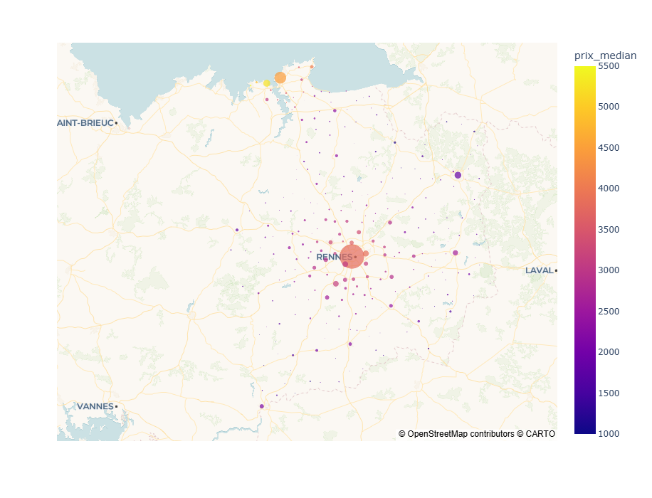

# DVF Ille-Et-Vilaine



Le projet exploration_dvf.ipynb permet d'obtenir un jeu de données clair et lisible en mettant en avant les caractéristiques des biens immobiliers dans le département de l'ille-et-Vilaine (le nombres de ventes, le prix médian du m², la surface médiane, le prix médian du m² pour un appartement et pour une maison). 

Les données brutes ont été extraites du site data.gouv : https://www.data.gouv.fr/datasets/demandes-de-valeurs-foncieres-geolocalisees 
Les données extraites concernent le département de l'ille-et-Vilaine (35) en Bretagne.

Selon le dataset, une ligne correspond à un bien et non à une vente. le projet permet de conserver uniquement les mutations qui correspondent à un seul bien (selon l'id de la mutation). Le dataset est alors passé de 60 245 lignes à seulement, 13 251 biens.
Pour la suite du projet, une colonne prix_m² a été ajoutée (calculée en divisant la valeur foncière par la surface réelle bâtie).
La décision d'exclure les biens avec un prix au mètre carré en dehors de la fourchette [300:15 000]€ a été prise dans le but de conserver uniquement les ventes réalistes. Le dataset se compose alors de 13136 biens. 
Dans le but d'avoir des données réalistes, seules les communes avec au moins 5 ventes sont conservées. 

## Résultats
Le résultat présente un dataset qui met en lumière l'écart entre les biens vendus sur la côte et dans l'espace rural du département (De 839 €/m² à Villamée à 5 546 €/m² à Saint-Briac-sur-Mer, soit un rapport de 1 à 6). 
Le fichier de visualisation permet de mettre en perspective les 20 communes dont le prix médian au m² est le plus élevé en fonction du nombre de ventes. 
Il permet également d'afficher une carte intéractive avec les informations ville par ville (nombre de ventes, prix médian au m²)

## Jeu de données produit

`output/prix_m2_communes_35_2025.csv` — une ligne par commune.

| Colonne | Type | Description |
|---|---|---|
| `code_commune` | texte | Code INSEE de la commune |
| `nom_commune` | texte | Nom de la commune |
| `nb_ventes` | entier | Nombre de transactions retenues |
| `prix_median` | entier | Prix médian au m² (€) |
| `surface_mediane` | entier | Surface bâtie médiane (m²) |
| `prix_median_maison` | entier | Prix médian au m² des maisons (€) |
| `prix_median_appartement` | entier | Prix médian au m² des appartements (€) |
| `latitude` / `longitude` | décimal | Barycentre des transactions de la commune |

## Limites
Le prix de la mutation est attribué au bien principal, les dépendances sont incluses dans le prix mais pas dans la surface.
les données portent uniquement sur l'année 2025, il n'y a donc pas d'évolution temporelle. 
L’effet de composition interdit de comparer directement maisons et appartements.
Les coordonnées sont le barycentre des transactions, pas le centre administratif

## Reproduire

```bash
git clone https://github.com/CorollerAntoine/dvf_ille_et_vilaine.git
cd dvf_ille_et_vilaine
py -3.12 -m venv .venv
.venv\Scripts\activate
pip install -r requirements.txt
```

Télécharger le fichier du département 35 (année 2025) depuis data.gouv
et le placer dans `data/35.csv.gz`, puis exécuter les notebooks dans l'ordre :
`exploration_dvf.ipynb` puis `visualisation.ipynb`.

## Stack

Python 3.12, Pandas, Numpy, Plotly, Git